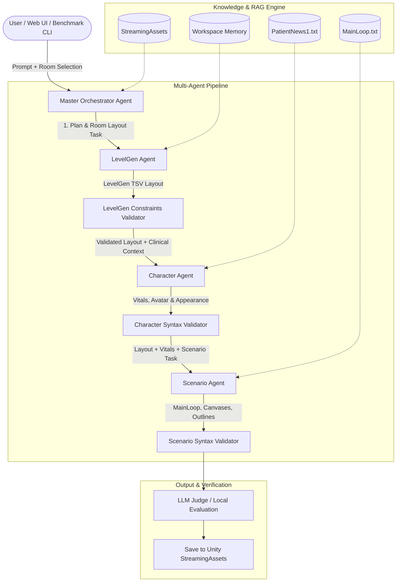

# Cerebrum Multi-Agentic Studio & RemoteMCP Server

> **An agentic orchestration server, MCP daemon, and multi-agent synthesis studio for generating, validating, and benchmarking Unity Cerebrum simulation scripts.**

---

## Table of Contents
1. [Overview](#overview)
2. [Key Features](#key-features)
3. [Architecture & Pipeline](#architecture--pipeline)
4. [Prerequisites & Environment Setup](#prerequisites--environment-setup)
5. [Model Configuration (Local vs. Cloud)](#model-configuration-local-vs-cloud)
   - [Local Models via Ollama](#local-models-via-ollama)
   - [Cloud Models via Google Gemini](#cloud-models-via-google-gemini)
   - [Runtime Switching](#runtime-switching)
6. [Running the Application](#running-the-application)
   - [Running the Root Server](#1-running-the-root-server)
   - [Running the MCP Daemon](#2-running-the-mcp-daemon)
   - [Accessing the Web Studio](#3-accessing-the-web-studio)
7. [Running the Multi-Agent Pipeline](#running-the-multi-agent-pipeline)
   - [Via Web UI](#via-web-ui)
   - [Via HTTP API](#via-http-api)
8. [Benchmarking Suite](#benchmarking-suite)
   - [Running Benchmarks](#running-benchmarks)
   - [CLI Options & Flags](#cli-options--flags)
   - [Metrics & Evaluation Report](#metrics--evaluation-report)
9. [Project Codebase Breakdown](#project-codebase-breakdown)
10. [Cerebrum Script Specifications & Validation](#cerebrum-script-specifications--validation)
11. [New Contributor Guide & Recipes](#new-contributor-guide--recipes)
12. [Troubleshooting & FAQ](#troubleshooting--faq)

---

## Overview

**Cerebrum** is a Unity-based medical simulation training platform that executes clinical scenarios using a custom domain-specific scripting language and procedural level generator (`LevelGen`). 

Writing and coordinating these scripts manually requires strict syntax adherence across three interdependent layers:
1. **LevelGen Layouts (`.txt`)**: Tab-separated spatial placement of medical equipment, furniture, monitors, and nurse stations within defined room zone boundaries.
2. **Character & Patient Setup (`.txt`)**: Initializing clinical vitals (`$Temperature`, `$HR`, `$BP`, `$SpO2`), instantiating patient avatars, bed alignment, and modular appearance blendshapes.
3. **Scenario Logic (`.txt`)**: Clinical workflow execution, UI canvas triggers, interactive object click handling, throttled event loops (`Label 'MainLoop' ... Wait .2 ... Goto 'MainLoop'`), and evaluation branches.

This repository provides an automated **Multi-Agent Orchestration Pipeline** that transforms high-level clinical scenario descriptions into syntactically valid, cross-checked Cerebrum scripts ready for immediate use in Unity.

---

## Key Features

- 🤖 **Sequential Multi-Agent Architecture**: A Master Orchestrator delegates tasks to specialized sub-agents (LevelGen, Character, and Scenario) with state propagation between stages.
- 📐 **Deterministic Constraints Engine**: Built-in room constraint maps (`ROOM_CONSTRAINTS`), preventing invalid zone-object mappings, missing vital signs, or unthrottled infinite loops.
- 📚 **Retrieval-Augmented Generation (RAG)**: Automatically prioritizes authentic reference scripts (`MainLoop.txt`, `PatientNews1.txt`, manual/corrected examples) to maintain domain fidelity.
- 🔄 **Dual Model Backend**: Seamlessly toggle between **local open-weights models** via Ollama (e.g., Gemma 3 4B, Gemma 4) and **cloud models** via Google Gemini (e.g., Gemini 2.0 Flash / Pro).
- ⏱️ **Integrated Benchmarking Suite**: Automated latency, token throughput, constraint compliance, and LLM-as-a-judge evaluation scoring with one command.
- 🔌 **Model Context Protocol (MCP) Compatible**: Implements tool calling (filesystem read/write, bash execution, git) over WebSocket and HTTP for AI IDEs and external agents.

---

## Architecture & Pipeline

The pipeline uses a staged, multi-agent workflow:



### Pipeline Flow:
1. **Master Orchestrator**: Analyzes the clinical prompt, selects appropriate room archetypes, and produces a structured JSON simulation plan.
2. **LevelGen Agent**: Generates room layout configurations respecting room zone limits and equipment dependencies.
3. **Character Agent**: Receives the orchestrator plan and layout context, generating patient clinical variables, vitals, avatar bed alignment, and modular appearance scripts.
4. **Scenario Agent**: Synthesizes the master plan, patient setup, and room equipment into a throttled interactive event loop with object click handlers.
5. **Constraint Engine**: Validates every script against domain rules (e.g., paired `Label`/`Goto`, `Wait` statement throttling, vitals completeness).
6. **Persistence**: Saves generated files directly into Unity's `StreamingAssets/Scenarios/` and `StreamingAssets/LevelGen/`.

---

## Prerequisites & Environment Setup

### System Requirements
- **Operating System**: Windows 10/11, macOS, or Linux
- **Node.js**: v20.0.0 or higher
- **npm**: v10.0.0 or higher
- **Unity** (Optional, for simulation playback): Unity 2021.3+ with the Cerebrum project
- **Ollama** (Optional, for local LLM inference): [ollama.com](https://ollama.com)

### Reproducible Setup via Conda (`environment.yml`)

A reproducible environment specification is provided in [environment.yml](file:///c:/Users/afree/RiderProjects/RemoteMCPServer/environment.yml):

```bash
# 1. Create and activate the conda environment
conda env create -f environment.yml
conda activate cerebrum-remotemcp

# 2. Install root server dependencies
npm install

# 3. Install daemon dependencies
cd MCP/remoteMCP/daemon
npm install
cd ../../..
```

---

## Model Configuration (Local vs. Cloud)

The server supports both local inference via **Ollama** and cloud inference via **Google Gemini**. Configuration is handled through `.env` files.

### Configuration Files
- Root server config: [.env](file:///c:/Users/afree/RiderProjects/RemoteMCPServer/.env)
- Daemon server config: [MCP/remoteMCP/daemon/.env](file:///c:/Users/afree/RiderProjects/RemoteMCPServer/MCP/remoteMCP/daemon/.env)

### Local Models via Ollama

Using local open-source models allows private, offline execution without cloud API costs.

1. **Install and launch Ollama**:
   ```bash
   # In a separate terminal
   ollama serve
   ```

2. **Pull the recommended models**:
   ```bash
   # Recommended default model
   ollama pull gemma3:4b

   # High-efficiency alternative
   ollama pull gemma4:e2b

   # Clinical / general reasoning alternatives
   ollama pull llama3:8b
   ollama pull mistral:7b
   ```

3. **Configure your `.env` file**:
   ```env
   MODEL_PROVIDER=ollama
   OLLAMA_URL=http://localhost:11434
   OLLAMA_MODEL=gemma3:4b
   WORKSPACE_ROOT="C:\Unity Projects\MCPCerebrum\MCPCerebrum"
   ```

### Cloud Models via Google Gemini

Gemini provides higher-parameter reasoning, multi-turn tool calling, and multimodal image input.

1. **Obtain an API key** from [Google AI Studio](https://aistudio.google.com/).
2. **Configure your `.env` file**:
   ```env
   MODEL_PROVIDER=gemini
   GEMINI_API_KEY=AIzaSy...your_actual_api_key_here
   GEMINI_MODEL=gemini-3.6-flash
   WORKSPACE_ROOT="C:\Unity Projects\MCPCerebrum\MCPCerebrum"
   ```

### Runtime Switching
You can switch providers at any time:
- **In `.env`**: Change `MODEL_PROVIDER=ollama` to `MODEL_PROVIDER=gemini`.
- **In Web Studio**: Use the top-right model selector dropdown to toggle between connected Ollama models and Gemini models without restarting the server.

---

## Running the Application

The repository contains two operational components:

| Component | Default Port | Entry Point | Primary Role |
|---|---|---|---|
| **Root Server** | `3000` | [server.js](file:///c:/Users/afree/RiderProjects/RemoteMCPServer/server.js) | Standalone Express server, studio web interface, sequential RAG routes. |
| **MCP Daemon** | `3333` | [MCP/remoteMCP/daemon/src/index.js](file:///c:/Users/afree/RiderProjects/RemoteMCPServer/MCP/remoteMCP/daemon/src/index.js) | MCP tool server, WebSocket agent loop, multi-agent orchestration, and benchmarking backend. |

### 1. Running the Root Server
```bash
npm start
# Server starts on http://localhost:3000
```

### 2. Running the MCP Daemon
```bash
cd MCP/remoteMCP/daemon
npm start
# Daemon starts on http://localhost:3333 (WebSocket + HTTP)
```

### 3. Accessing the Web Studio
Open your browser and navigate to:
- **Multi-Agent Studio (Root)**: `http://localhost:3000`
- **MCP Studio (Daemon)**: `http://localhost:3333` or `http://localhost:3333/studio.html`
- **LevelGen Generator**: `http://localhost:3333/levelgen.html`

---

## Running the Multi-Agent Pipeline

### Via Web UI

1. Open `http://localhost:3000` in your web browser.
2. Select a target **Room Archetype** (e.g., `RoomMedExam_base`, `RoomLrgPatient_base`, `RoomXLGPatient_base`).
3. Enter your scenario prompt in the **Clinical Scenario Prompt** textarea, for example:
   > *"Emily is a 28-year-old patient admitted to RoomMedExam_base presenting with a fever. A nurse enters, washes hands, explains the examination, records vital signs (Temperature 39.1, HR 98, SpO2 96), and presents examination choices."*
4. Select any additional reference context files using the **File Selector** panel.
5. Click **"🚀 Generate All (Sequential Pipeline)"**.
6. Watch the real-time execution cards:
   - **Orchestration Plan**: Breaks down tasks and clinical phases.
   - **LevelGen Output**: Generated layout + zone validation status.
   - **Character Output**: Clinical vitals, avatar model, bed alignment, and blendshapes.
   - **Scenario Output**: Event loop, canvas toggles, button click resets, and Return statement.
   - **Pipeline Timings**: Breakdown of latency per phase.
7. Click **"Save to Unity"** under any generated tab to write the file directly to your configured Unity `StreamingAssets` directory.

### Via HTTP API

You can trigger the pipeline programmatically using `curl`, Python, or any HTTP client:

#### Endpoint: `POST /api/orchestrate/generate-sequential` (or `/generate-sequential`)

```bash
curl -X POST http://localhost:3333/api/orchestrate/generate-sequential \
  -H "Content-Type: application/json" \
  -d '{
    "prompt": "45-year-old male with acute chest pain admitted to RoomMedExam_base. Nurse performs triage, checks vitals (BP 150/95, HR 105, SpO2 94), and aligns patient on bed.",
    "roomName": "RoomMedExam_base",
    "fileName": "ChestPainScenario"
  }'
```

#### Sample JSON Response:
```json
{
  "ok": true,
  "orchestratorPlan": {
    "room_name": "RoomMedExam_base",
    "levelgen_task": "Place MedExam bed, Screen, and Bedside cart...",
    "character_task": "Generate patient John, 45yo, BP 150/95, HR 105...",
    "scenario_task": "MainLoop throttled event loop checking examination buttons..."
  },
  "order": ["levelgen", "character", "scenario"],
  "results": {
    "levelgen": { "content": "Bed\t1\t1\n...", "eval": { "pass": true, "warnings": [] } },
    "character": { "content": "$PatientName = 'John'\n...", "eval": { "pass": true, "warnings": [] } },
    "scenario": { "content": "Label 'MainLoop'\n...", "eval": { "pass": true, "warnings": [] } }
  },
  "timings": {
    "planningMs": 1120.5,
    "levelgenMs": 2430.1,
    "characterMs": 2180.4,
    "scenarioMs": 3520.8,
    "totalPipelineMs": 9251.8
  }
}
```

---

## Benchmarking Suite

The project includes an automated benchmark harness ([benchmark-levelgen.js](file:///c:/Users/afree/RiderProjects/RemoteMCPServer/MCP/remoteMCP/daemon/benchmark-levelgen.js)) that profiles latency, syntax correctness, and model performance.

### Running Benchmarks

Inside the `MCP/remoteMCP/daemon` directory:

```bash
# Run default benchmark (Ollama gemma3:4b)
npm run benchmark

# Run benchmark using Google Gemini cloud model
npm run benchmark -- --provider gemini --model gemini-3.6-flash

# Run with custom prompt, room, and cloud model
npm run benchmark -- --provider gemini --model gemini-2.5-pro --room RoomMedExam_base --prompt "Patient with severe asthma..."

# Run without starting daemon automatically (connect to existing instance)
node benchmark-levelgen.js --base-url http://localhost:3333 --no-auto-start

# Skip model judge evaluation to measure raw generation speed
npm run benchmark -- --skip-eval
```

### CLI Options & Flags

| Flag | Short | Default | Description |
|---|---|---|---|
| `--prompt` | `-p` | *(Fever scenario)* | Clinical test scenario prompt passed to the orchestrator. |
| `--room` | | `RoomMedExam_base` | Target room archetype to validate layout constraints against. |
| `--provider` | `-P` | `process.env.MODEL_PROVIDER` (`ollama`) | Model provider backend (`ollama` or `gemini`). |
| `--model` | `-m` | `gemma3:4b` / `gemini-2.0-flash` | Specific LLM model identifier to execute. |
| `--skip-eval` | | `false` | Skips LLM-as-a-judge evaluation to speed up benchmarking. |
| `--no-auto-start` | | `false` | Prevents automatically spawning the daemon if not currently active. |
| `--base-url` | | `http://localhost:3333` | Target server URL for benchmarking API requests. |

### Metrics & Evaluation Report

The benchmark prints a structured performance card upon completion:

```
===========================================================================
  🚀 CEREBRUM MULTI-AGENT PIPELINE BENCHMARK (Revamped)
===========================================================================
📡 Target Daemon:  http://localhost:3333
🎯 Target Room:    RoomMedExam_base
📝 Test Prompt:    "Emily is a 28-year-old patient admitted to RoomMedExam_base..."
🔍 LLM Evaluation: ENABLED
===========================================================================

📋 Phase 1: Multi-Agent Orchestrator Planning (1.24s)
🛠️ Phase 2: LevelGen Agent Execution (2.45s) -> Syntax Pass: YES
👤 Phase 3: Character Agent Execution (2.12s) -> Clinical Vitals: YES
🎬 Phase 4: Scenario Agent Execution (3.61s) -> Loop Throttled: YES
🔍 Phase 5: Cerebrum Syntax Evaluation (0.05s)

===========================================================================
  📊 BENCHMARK SUMMARY & METRICS
===========================================================================
Phase / Component               Duration       Output Size    Pass?   Warnings
---------------------------------------------------------------------------
1. Orchestrator Planning        1.24s          -              YES     0
2. LevelGen Agent               2.45s          1.3 KB         YES     0
3. Character Agent              2.12s          1.8 KB         YES     0
4. Scenario Agent               3.61s          4.2 KB         YES     0
---------------------------------------------------------------------------
Total Pipeline Duration:        9.42s
Overall Syntactic Pass:         YES (All checks passed)
LLM Judge Verdict:              APPROVED
===========================================================================
```

---

## Project Codebase Breakdown

```
RemoteMCPServer/
├── .env                                # Root environment config (model provider, paths)
├── environment.yml                     # Conda environment specification
├── package.json                        # Root dependencies & scripts
├── server.js                           # Express server on port 3000 (Studio + API bridge)
├── MainLoop.txt                        # Authentic reference script for scenario loops
├── CerebrumScriptingGuide_1.2.0.txt    # Official Cerebrum grammar & syntax reference
├── Workspace Memory.txt                # System knowledge base for LevelGen
├── Workspace Memory Scenario.txt       # System knowledge base for Scenario scripting
│
├── public/                             # Root web client assets
│   └── index.html                      # Cerebrum Multi-Agentic Studio dashboard
│
└── MCP/
    └── remoteMCP/
        └── daemon/
            ├── .env                    # Daemon environment config (Gemini key, Ollama settings)
            ├── package.json            # Daemon dependencies & scripts (benchmark, start)
            ├── benchmark-levelgen.js   # Automated multi-agent benchmarking tool
            ├── Workspace Memory Character.txt  # Character agent domain memory
            │
            ├── Patient/
            │   └── PatientNews1.txt    # Authentic patient clinical vitals reference
            │
            ├── Scenario/
            │   └── MainLoop.txt        # Authentic scenario event loop reference
            │
            ├── src/
            │   ├── index.js            # Main daemon server (port 3333, MCP tools, WebSockets)
            │   ├── levelgenRoutes.js   # Sequential multi-agent pipeline & RAG router
            │   ├── levelgenConstraints.js # Room layout constraints & localEvaluate validator
            │   ├── unityScriptRag.js   # Unity project context search and script analyzer
            │   │
            │   ├── tools/
            │   │   ├── toolRegistry.js # MCP tool definitions (filesystem, terminal execution)
            │   │   └── toolSchemas.json# JSON schemas for function declarations
            │   │
            │   └── prompts/
            │       ├── planner.txt     # Orchestration planning system prompt
            │       ├── executor.txt    # Execution agent prompt
            │       └── reviewer.txt    # Evaluation reviewer prompt
            │
            └── public/                 # Daemon web UI files (studio.html, levelgen.html)
```

### Core Files Explained

- [server.js](file:///c:/Users/afree/RiderProjects/RemoteMCPServer/server.js): Starts the root Express server, serves the Multi-Agentic Studio, handles RAG indexing across project directories, and proxies generation requests.
- [MCP/remoteMCP/daemon/src/index.js](file:///c:/Users/afree/RiderProjects/RemoteMCPServer/MCP/remoteMCP/daemon/src/index.js): Core MCP Daemon. Manages model switching between Ollama and Gemini, handles bidirectional WebSockets, and manages tool invocation loops.
- [MCP/remoteMCP/daemon/src/levelgenRoutes.js](file:///c:/Users/afree/RiderProjects/RemoteMCPServer/MCP/remoteMCP/daemon/src/levelgenRoutes.js): Defines `/generate-sequential` and orchestrates the 3-step agent generation (LevelGen -> Character -> Scenario).
- [MCP/remoteMCP/daemon/src/levelgenConstraints.js](file:///c:/Users/afree/RiderProjects/RemoteMCPServer/MCP/remoteMCP/daemon/src/levelgenConstraints.js): Houses `ROOM_CONSTRAINTS` for each room geometry and implements `localEvaluate(script, mode)` to validate syntax rules.
- [MCP/remoteMCP/daemon/benchmark-levelgen.js](file:///c:/Users/afree/RiderProjects/RemoteMCPServer/MCP/remoteMCP/daemon/benchmark-levelgen.js): Automated profiling and evaluation harness.

---

## Cerebrum Script Specifications & Validation

The deterministic validation engine in `levelgenConstraints.js` enforces specific syntax rules for each output type:

### 1. LevelGen Files (`.txt` TSV)
- **Format**: `Zone \t ZoneNumber \t ObjectNumber` (e.g., `Bed\t1\t1`).
- **Zone Constraints**: Objects can only be placed in zones that exist for that room (e.g., `RoomMedExam_base` allows `Bed` zones 1-3, `Wall` zones 1-3, `Screen` zones 1-4).
- **Sanitization**: Any hallucinated zone names or out-of-range indices are automatically mapped to valid room defaults.

### 2. Character Setup Files (`.txt`)
- **Clinical Variables**: Must declare patient vitals:
  ```cerebrum
  $PatientName = 'Emily'
  $PatientAge = 28
  $Temperature = 39.1
  $HR = 98
  $BP = '120/80'
  $SpO2 = 96
  ```
- **Avatar Instantiation & Bed Alignment**:
  ```cerebrum
  Create $PatientModel $PatientObjName
  $PatientObjName align $PatientBedLoc 0
  ```
- **Modular Blendshapes**: Calls authentic sub-scripts:
  ```cerebrum
  Do 'NEWS_Nurse/PatientCreations/Age/25.txt'
  Do 'NEWS_Nurse/PatientCreations/Expressions/Frown.txt'
  Return
  ```

### 3. Scenario Logic Files (`.txt`)
- **Canvases & Outlines**: Enables UI interaction:
  ```cerebrum
  Canvases on
  Object outlines.on
  ```
- **Throttled MainLoop**: Loops must be throttled with `Wait` to prevent freezing Unity's main thread:
  ```cerebrum
  Label 'MainLoop'
  Wait .2
  # Event checks...
  Goto 'MainLoop'
  Return
  ```
- **Click Resets**: Interactive clicked objects must reset `$Object` to avoid repeated triggers:
  ```cerebrum
  If $Object == 'Stethoscope' Then
      $Object = ''
      # Action logic...
  Endif
  ```

---

## New Contributor Guide & Recipes

### Adding a New Room Model
1. Open [MCP/remoteMCP/daemon/src/levelgenConstraints.js](file:///c:/Users/afree/RiderProjects/RemoteMCPServer/MCP/remoteMCP/daemon/src/levelgenConstraints.js).
2. Add your room configuration to `ROOM_CONSTRAINTS`:
   ```javascript
   export const ROOM_CONSTRAINTS = {
     // ...
     RoomICU_base: {
       Bed: [1, 2],
       Wall: [1, 2, 3, 4],
       Monitor: [1, 2],
       Ventilator: [1]
     }
   };
   ```
3. Add reasonable fallback placement defaults in `ROOM_DEFAULTS`.

### Adding a Validation Rule
In `levelgenConstraints.js`, add checks inside the `localEvaluate(script, mode)` function:
```javascript
if (mode === "scenario") {
  if (!lines.some(l => l.includes("Canvases on"))) {
    warnings.push("Scenario does not explicitly enable Canvases.");
  }
}
```

### Adding an MCP Tool
1. Define the tool schema in [MCP/remoteMCP/daemon/src/tools/toolSchemas.json](file:///c:/Users/afree/RiderProjects/RemoteMCPServer/MCP/remoteMCP/daemon/src/tools/toolSchemas.json).
2. Implement the handler function in [MCP/remoteMCP/daemon/src/tools/toolRegistry.js](file:///c:/Users/afree/RiderProjects/RemoteMCPServer/MCP/remoteMCP/daemon/src/tools/toolRegistry.js).
3. The tool is automatically registered for model tool-calling loops.

---

## Troubleshooting & FAQ

#### Q: The browser UI shows `Failed to fetch` or connection refused.
- **Fix**: Ensure either `server.js` (port 3000) or `daemon` (port 3333) is running. If both are used simultaneously, verify their ports do not conflict in [.env](file:///c:/Users/afree/RiderProjects/RemoteMCPServer/.env).

#### Q: Ollama returns `model not found`.
- **Fix**: Run `ollama list` to inspect installed models. Pull the missing model with `ollama pull <model-name>` matching your `OLLAMA_MODEL` setting in `.env`.

#### Q: Unity does not reflect generated files.
- **Fix**: Check `WORKSPACE_ROOT` in your `.env`. Ensure it points to your Unity project root so that files write into `Assets/StreamingAssets/Scenarios` and `Assets/StreamingAssets/LevelGen`.

#### Q: Can I run without Unity installed?
- **Yes**: The server, UI, multi-agent pipeline, constraints validator, and benchmark test suite operate completely independently of Unity. Unity is only needed if you wish to run the 3D simulation live.

---

## License
MIT License. Created for the Cerebrum Simulation Project.
